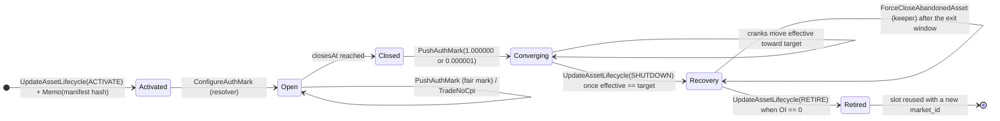
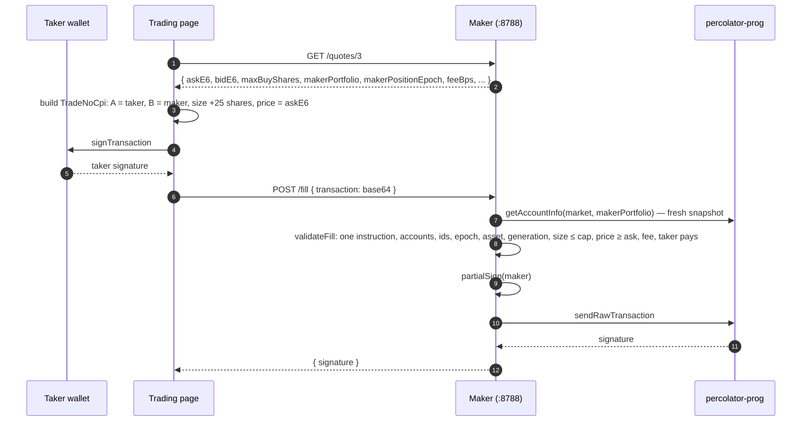
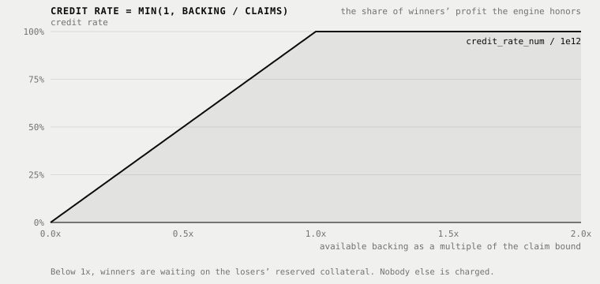
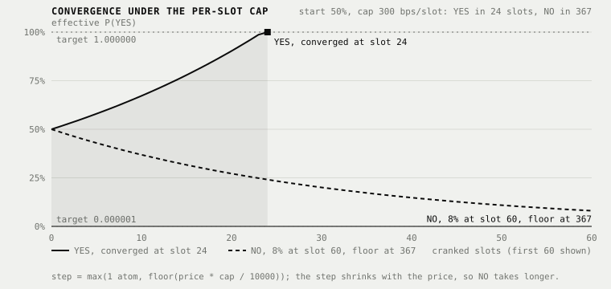
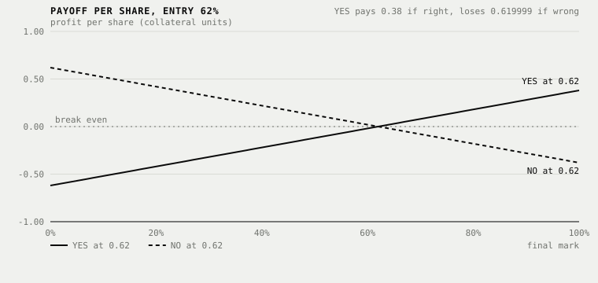
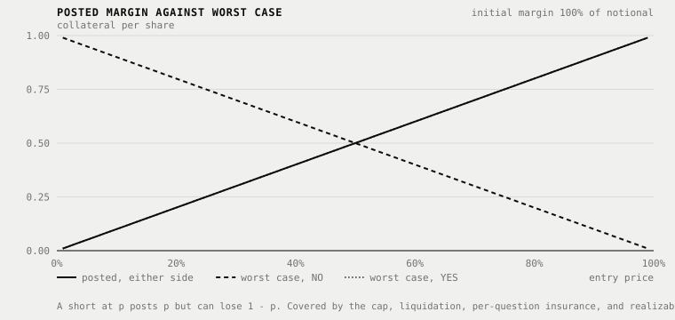
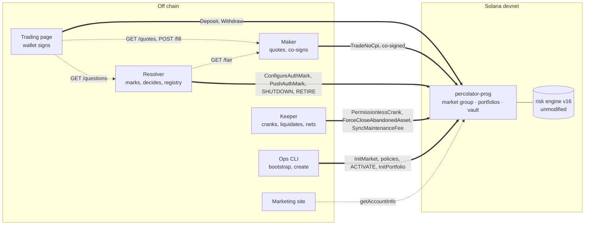
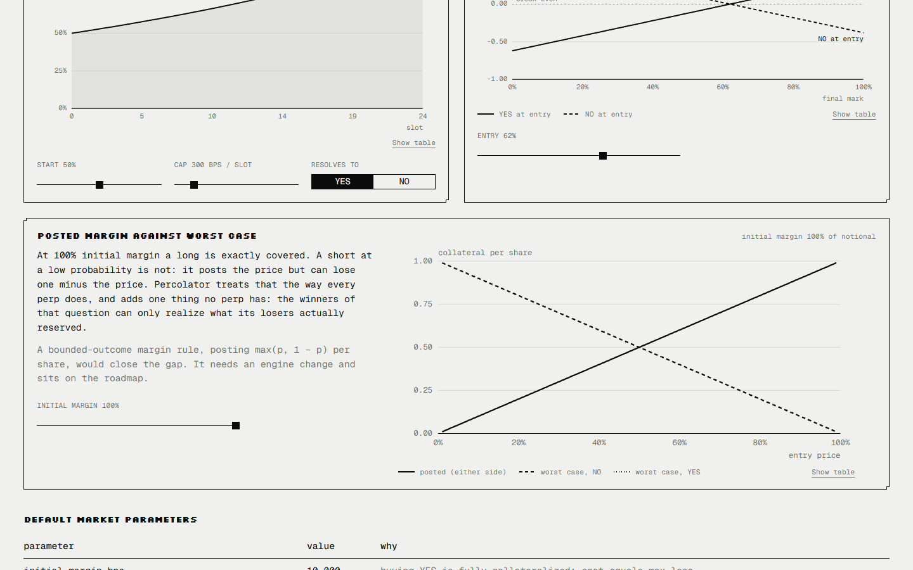
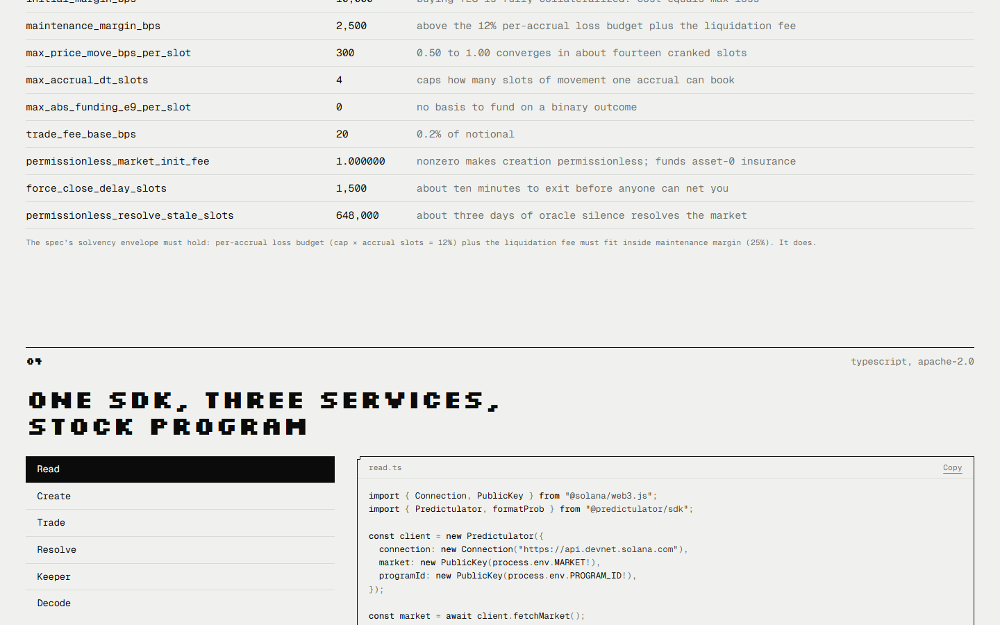

<p align="center">
  
</p>

<h1 align="center">Predictulator</h1>

<p align="center"><b>Prediction markets on Solana where a wrong resolution can only hurt the people who bet on that question.</b></p>

<p align="center">
  <a href="https://gpux.si">site</a> ·
  <a href="docs/DESIGN.md">design</a> ·
  <a href="docs/OPERATIONS.md">runbook</a> ·
  <a href="docs/ROADMAP.md">roadmap</a> ·
  <a href="https://github.com/aeyakovenko/percolator">engine</a> ·
  <a href="https://github.com/aeyakovenko/percolator-prog">program</a>
</p>

> **Devnet only. Not audited. Test tokens only.** The engine underneath is itself an unaudited research project. The on-chain program used here is stock upstream `percolator-prog`, unmodified. Everything in this repository is client-side TypeScript.

**v0.2 (November 2026).** Layouts are now machine-checked against the pinned Rust (`npm run verify:layouts`, 21 structs, and its first run caught a 32-byte drift). A chain indexer rebuilds the question list from activation transactions and audits a resolver's registry against it. An MCP server lets an agent read questions, explain the credit rate, price a trade, and build an unsigned transaction for a wallet to sign. The trading page can close a leg and convert backed profit. Details in [CHANGELOG.md](CHANGELOG.md) and sections [8.1](#81-layouts-are-declarative-and-derived-not-hand-offset), [9.5](#95-indexer-questions-from-chain-not-from-an-api), and [9.6](#96-mcp-server-the-sdk-as-eight-tools).

---

## Contents

1. [The one-paragraph version](#1-the-one-paragraph-version)
2. [Why a perp risk engine is the right substrate for prediction markets](#2-why-a-perp-risk-engine-is-the-right-substrate-for-prediction-markets)
3. [The mapping: question → asset slot](#3-the-mapping-question--asset-slot)
4. [Lifecycle of a question](#4-lifecycle-of-a-question)
5. [Containment, quantified](#5-containment-quantified)
6. [Mechanics, drawn from the rules](#6-mechanics-drawn-from-the-rules)
7. [Architecture and trust](#7-architecture-and-trust)
8. [The SDK: layouts, encoders, client](#8-the-sdk-layouts-encoders-client)
9. [The services: resolver, maker, keeper, ops, indexer, MCP](#9-the-services-resolver-maker-keeper-ops)
10. [HTTP API](#10-http-api)
11. [Verification: what is proven, what is tested, what is not](#11-verification-what-is-proven-what-is-tested-what-is-not)
12. [Running it](#12-running-it)
13. [Open questions for upstream](#13-open-questions-for-upstream)
14. [Repository map](#14-repository-map)
15. [License and attribution](#15-license-and-attribution)

---

## 1. The one-paragraph version

Every prediction-market question is an asset slot inside one [Percolator](https://github.com/aeyakovenko/percolator) market group. Price is P(YES) scaled by 1e6. Buying YES is going long; buying NO is going short. The resolver is the slot's `oracle_authority`: it steers the mark while the question is open, pushes `1_000_000` or `1` when it resolves, waits for the engine to converge, and shuts the slot down at the frozen mark. A keeper nets longs against shorts, permissionlessly, until open interest is zero. The slot is retired and reused under a new generation id. Percolator's core invariant, that positive PnL from a source domain is usable only up to that domain's reserved counterparty backing, means a wrong resolution or a manipulated thin question is contained to that question's own longs and shorts. It cannot reach the vault, other questions, or anyone else's capital.

| | |
| --- | --- |
| On-chain program | Upstream `percolator-prog` at `5cb331dd`, engine crate at `4db11a8c`. Zero lines modified. |
| This repo | TypeScript SDK (layouts, encoders, client), resolver, RFQ maker, keeper, ops CLI, trading page, marketing site. |
| Tests | 59 unit tests: byte-exact instruction encoders, Pod layouts cross-checked against the engine's compile-time size assertion, lifecycle decisions, force-close pairing, fill validation. |
| Not yet | Run against a live devnet market. This machine has no Rust toolchain, so the program has not been built or deployed from here. Section 11 is precise about this. |

---

## 2. Why a perp risk engine is the right substrate for prediction markets

Prediction markets today sit at one of two extremes.

**Fully collateralized CLOBs** (Polymarket-style): every share is backed 1:1 at mint. Safe, capital-inefficient, no cross-margin, no leverage. A trader with high conviction across ten questions needs ten separate full-size stakes.

**Perp DEX listings** of event contracts: capital-efficient, cross-margined, but a wrong oracle on one thin market can print PnL that gets withdrawn or used as margin elsewhere before anyone can react. The vault pays for the oracle's mistake.

Percolator was built to make the second model safe for permissionless, untrusted assets. The spec's core invariant:

```text
usable_positive_credit_from_source_domain
    <= realizable_counterparty_backing_reserved_for_that_domain
```

and in code, from `percolator/src/v16.rs`:

```rust
fn expected_source_credit_rate_num_for_state(state: SourceCreditStateV16) -> V16Result<u128> {
    Self::validate_source_credit_state_shape_static(state)?;
    if state.positive_claim_bound_num == 0 {
        return Ok(CREDIT_RATE_SCALE);
    }
    let available = Self::available_backing_num_for_source_credit_state(state)?;
    if available == 0 {
        return Ok(0);
    }
    let rate = U256::from_u128(available)
        .checked_mul(U256::from_u128(CREDIT_RATE_SCALE))
        .and_then(|v| v.checked_div(U256::from_u128(state.positive_claim_bound_num)))
        .and_then(|v| v.try_into_u128())
        .ok_or(V16Error::ArithmeticOverflow)?;
    Ok(core::cmp::min(rate, CREDIT_RATE_SCALE))
}
```

where available backing is the losing side's reserved collateral less what is already liened, plus unencumbered insurance credit:

```rust
fn available_backing_num_for_source_credit_state(state: SourceCreditStateV16) -> V16Result<u128> {
    if state.fresh_reserved_backing_num < state.valid_liened_backing_num {
        return Err(V16Error::InvalidConfig);
    }
    let insurance_encumbered = state
        .valid_liened_insurance_num
        .checked_add(state.impaired_liened_insurance_num)
        .ok_or(V16Error::ArithmeticOverflow)?;
    if state.insurance_credit_reserved_num < insurance_encumbered {
        return Err(V16Error::InvalidConfig);
    }
    (state.fresh_reserved_backing_num - state.valid_liened_backing_num)
        .checked_add(state.insurance_credit_reserved_num - insurance_encumbered)
        .ok_or(V16Error::ArithmeticOverflow)
}
```

For a question, the *source domain* of YES profit is the NO side of that same slot, and vice versa. That gives prediction markets a property neither existing model has:

| Property | Fully collateralized CLOB | Perp DEX | Predictulator on Percolator |
| --- | --- | --- | --- |
| Cross-margin across questions | no | yes | yes |
| Leverage | no | yes | yes, with a per-slot price brake |
| Capital required for a YES share at p | p, locked 1:1 | p × margin | p × margin |
| Wrong oracle on one market can drain the vault | no | yes | **no: bounded by that market's reserved backing** |
| Winners paid from other users' collateral | never | possible via socialized loss | **never across questions** |
| Permissionless market creation | varies | rare | yes, fee funds insurance |

The engine was designed for exactly the adversarial case prediction markets live in: a market whose price is set by an authority (the resolver) that might be wrong or malicious. Percolator does not try to detect that. It makes it unprofitable beyond one question's own order book. This repository adds the mapping, the lifecycle, and the services. It does not add trust.

---

## 3. The mapping: question → asset slot

| Prediction market concept | Percolator concept |
| --- | --- |
| Market (one collateral vault, many questions) | Market group account; asset 0 reserved as the base slot |
| Question | Asset slot `i ≥ 1` with generation `market_id` |
| P(YES) | `price`, scaled 1e6, in `[1, 1_000_000]` |
| Buy YES | Long, `size_q > 0` |
| Buy NO | Short, `size_q < 0` |
| One share | `POS_SCALE = 1_000_000` quantity units |
| A share pays 1.00 on YES | Price `1_000_000` atoms per share with a 6-decimal collateral |
| Resolution YES / NO | Final mark `1_000_000` / `1`, then shutdown at the frozen mark |
| Question creator | Activator of the slot; pays the creation fee; becomes `asset_admin` |
| Resolver | The slot's `oracle_authority`; also the shutdown signer via `marketauth` or `asset_admin` |
| Operator | `marketauth` |

**Price arithmetic.** `trade_notional = floor(|size_q| × exec_price / POS_SCALE)`. One share (`1_000_000` units) at `p = 620_000` costs `620_000` atoms, which is 0.62 USDC-like units, and is worth `1_000_000` atoms if YES.

**The one-atom floor.** The program rejects a zero price everywhere a price is taken:

```rust
fn ensure_valid_reported_trade_price(exec_price: u64) -> ProgramResult {
    if exec_price == 0 || exec_price > percolator::MAX_ORACLE_PRICE {
        return Err(PercolatorError::OracleInvalid.into());
    }
    Ok(())
}
```

So NO resolves to `0.000001`, not `0`. A YES holder loses `p − 0.000001` per share instead of `p`. At any realistic size the residue is dust; the SDK's `pnlAtMark` and `worstCaseLossAtoms` account for it exactly rather than rounding it away.

**Generations.** Slots are reused. Each activation gets a fresh `market_id` from the market group's monotonic `next_market_id`. Every leg, every trade instruction, every oracle push, and every manifest binds `(asset_index, market_id)`. A position or a signed intent on a retired question cannot touch its successor. The question key used throughout this repo is `market/asset_index/market_id`.

---

## 4. Lifecycle of a question

Eight steps, five program instructions, nothing added on chain.



### 4.1 Creation commits the manifest hash on chain

The chain stores a slot, a generation, and a mark. Humans need the question text, the resolution criteria, the dates, and who resolves it. That is a manifest: canonicalized JSON (sorted keys, no whitespace), SHA-256 hashed, signed by the creator, countersigned by the resolver on registration. The activation transaction carries the hash in an SPL Memo:

```text
predictulator:q:v1:<sha256 hex>
```

so an indexer can prove the question shown on a page is exactly the one the slot was created for, without trusting the resolver's API. The SDK's `buildCreateQuestion` emits, in one transaction: a system transfer for the new slot's rent (the market account grows by one slot and the program does not fund that), the memo, and the activation with the creation fee accounts.

### 4.2 Marks are targets, and shutdown freezes the effective price

The two facts that make resolution correct, both from `percolator-prog/src/v16_program.rs`.

Marks can only be pushed to an Active or DrainOnly slot:

```rust
fn require_asset_mark_pushable_view(group: &state::MarketViewMutV16<'_>, asset_index: usize) -> ProgramResult {
    if asset_index >= group.markets.len() {
        return Err(PercolatorError::EngineLockActive.into());
    }
    match group.markets[asset_index].engine.asset.lifecycle {
        2 | 3 => Ok(()),
        _ => Err(PercolatorError::EngineLockActive.into()),
    }
}
```

and shutdown freezes whatever the *effective* price is at that moment, not the pushed target:

```rust
ASSET_LIFECYCLE_ACTIVE | ASSET_LIFECYCLE_DRAIN_ONLY => {
    accrue_committed_funding_before_asset_shutdown_view(&mut profile, &mut group, asset_index, authenticated_slot)?;
    let frozen_mark = group.markets[asset_index].engine.asset.effective_price.get();
    if frozen_mark == 0 || frozen_mark > percolator::MAX_ORACLE_PRICE {
        return Err(PercolatorError::OracleInvalid.into());
    }
    group.force_asset_recovery_not_atomic(asset_index, authenticated_slot).map_err(map_v16_error)?;
    profile.mark_ewma_e6 = frozen_mark;
    // ...
    profile.last_good_oracle_slot = authenticated_slot;
}
```

`PushAuthMark` sets `raw_oracle_target_price`. The engine moves `effective_price` toward it by at most `max_price_move_bps_per_slot` per cranked slot. If the resolver shut the slot down one slot after pushing the final mark, the question would settle at a lagged price. The resolver therefore waits for `effective_price == raw_oracle_target_price` before sending SHUTDOWN, and the mark push can never happen after shutdown because Recovery is lifecycle `5`.

### 4.3 The exit window, then permissionless netting

After shutdown, `last_good_oracle_slot` is the shutdown slot. Force-close is gated on it:

```rust
let shutdown_slot = profile.last_good_oracle_slot;
if shutdown_slot == 0
    || authenticated_slot < shutdown_slot
    || authenticated_slot.saturating_sub(shutdown_slot) < cfg.force_close_delay_slots
{
    return Err(PercolatorError::EngineLockActive.into());
}
```

Within the window, holders can reduce or exit on their own. After it, anyone can submit a long and a short and net them at the frozen mark. Because positions are opened in matched pairs, every long in a Recovery slot has a short to net against, so this always terminates. The keeper's pairing is largest-against-largest so each transaction nets as much as possible (section 9.3).

### 4.4 Sequence of one trade



`TradeNoCpi` requires both portfolio owners to sign, so the maker is a co-signer, never a custodian. The `TradeCpi` path (LP opts into a matcher program once; fills no longer need its signature) is the production path upstream and is where an on-chain AMM would go (section 13).

---

## 5. Containment, quantified

The number that matters on a question page is not the probability. It is the credit rate per side.

<p align="center"></p>

Walk through a failure. A question has 10,000 units of YES claims outstanding against 10,000 of reserved NO-side backing; credit rate `1e12`, every atom of YES profit is spendable across the portfolio. The resolver is compromised and pushes YES on a question that should be NO. The NO side gets liquidated down; its reserved backing falls. At 4,000 of backing the YES side's credit rate is 40%: winners can withdraw or margin 40% of their paper profit. The other 60% is a claim on collateral that does not exist. It is not paid by the vault, not by insurance for other questions, not by other portfolios. It is simply unrealizable until, and unless, the losing side's backing is replenished.

Compare the same event on a perp DEX with socialized loss: the deficit is spread across every account in the vault.

What the SDK exposes:

```ts
const q = Predictulator.questionState(asset);
q.yesRealizable; // source_credit_short.credit_rate_num / 1e12 — how much YES profit the shorts have reserved for
q.noRealizable;  // source_credit_long.credit_rate_num / 1e12
```

The trading page prints these next to the probability as "YES profit realizable: 40%". The marketing site has an instrument where you drag the losers' backing under the winners' claims and watch the rate fall.

### 5.1 What containment does not do

- It does not detect a bad resolver. It bounds the resolver's reach.
- It does not protect a YES holder from a wrong NO resolution on *their* question. That loss is real and intended: you chose that resolver.
- It does not make shorts fully collateralized (section 6.3).

---

## 6. Mechanics, drawn from the rules

None of the curves below are market data. Each is computed from the engine's own rule or the SDK's own function; the generator is `scripts/readme-charts.mjs` and the same math drives the interactive versions on the site.

### 6.1 Convergence under the per-slot cap

<p align="center"></p>

Each cranked slot moves the effective price by at most `max_price_move_bps_per_slot` of its current value, and by at least one atom. With the default 300 bps, 0.50 to 1.00 takes 24 slots (about ten seconds). Resolution to NO takes longer because the step shrinks with the price, which is why the resolver's `await_convergence` state exists rather than a fixed delay.

### 6.2 Payoff

<p align="center"></p>

YES at p costs p and pays 1.000000; NO is the short of the same asset. The lines cross at the entry price and are mirror images down to the one-atom floor.

### 6.3 Margin, honestly

<p align="center"></p>

Margin is a percentage of notional, and notional is `shares × price`. A long at p posts p per share and can lose at most p: exactly covered at 100% initial margin. A short at p posts p but can lose `1 − p`. At `p = 0.20` the short is covered 1:4. This is the same shape as every perp (a short can lose more than its margin) and it is handled the same way:

1. The per-slot cap limits how much loss accrues between cranks.
2. Maintenance margin at 25% liquidates long before the cap-bounded loss exceeds posted collateral.
3. Liquidation shortfall hits that question's insurance budget and then that question's B domain. Never another question's.
4. The winning side's profit is realizable only up to the losing side's reserved backing (section 5).

A bounded-outcome margin rule, posting `max(p, 1 − p)` per share, would close the gap entirely and is the single most valuable engine change for this use case. It is out of scope for a client-side project and is the first item in section 13.

### 6.4 Default parameters and the solvency envelope

From `packages/ops/src/params.ts`:

| Parameter | Value | Reason |
| --- | ---: | --- |
| `initial_margin_bps` | 10,000 | Buying YES is fully collateralized. |
| `maintenance_margin_bps` | 2,500 | Must exceed the per-accrual loss budget plus liquidation fee (below). |
| `max_price_move_bps_per_slot` | 300 | Probabilities jump on news; 3%/slot resolves 0.5→1.0 in ~10 s while bounding per-crank loss. |
| `max_accrual_dt_slots` | 4 | Caps slots of movement one accrual can book. |
| `max_abs_funding_e9_per_slot` | 0 | A binary outcome has no basis to fund. |
| `trade_fee_base_bps` | 20 | 0.2% of notional. |
| `liquidation_fee_bps` | 100 | 20% of it to the cranker via policy. |
| `permissionless_market_init_fee` | 1.000000 | Nonzero makes creation permissionless; funds asset-0 insurance. |
| `force_close_delay_slots` | 1,500 | About ten minutes to exit after shutdown. |
| `permissionless_resolve_stale_slots` | 648,000 | About three days of oracle silence resolves the whole market. |

The spec's section 1.3 envelope must hold for every notional X:

```text
price_budget_bps     = max_price_move_bps_per_slot × max_accrual_dt_slots = 300 × 4 = 1,200
price_funding_loss_X = ceil(X × 12%)                         (funding budget is 0)
worst_liq_notional_X = ceil(X × 1.12)
liq_fee_X            = ceil(worst_liq_notional_X × 1%)  ≈ X × 1.12%
mm_req_X             = max(ceil(X × 25%), min_nonzero_mm_req)

require 12% + 1.12% ≤ 25%     ✓
```

The three-day staleness valve is the safety net if the resolver disappears: `permissionless_stale_matured` lets anyone resolve the market, and the engine's terminal payout path pays everyone out pro rata from what actually exists.

```rust
pub fn permissionless_stale_matured(config: &WrapperConfigV16, now_slot: u64) -> bool {
    config.permissionless_resolve_stale_slots != 0
        && now_slot.saturating_sub(config.last_good_oracle_slot) >= config.permissionless_resolve_stale_slots
}
```

---

## 7. Architecture and trust



Solid edges are transactions; dotted edges are HTTP JSON. Nothing off chain holds anyone's funds.

| Actor | Trust | Why that is the ceiling |
| --- | --- | --- |
| Resolver | Trusted for its questions | It pushes the mark and decides the outcome, like UMA for Polymarket or the house for a sportsbook. Percolator bounds its reach to the reserved collateral of the losing side of each question it resolves. |
| Maker | Not trusted with funds | Co-signs trades against its own portfolio. Can refuse to quote. Cannot take anything, cannot be the fee payer, rejects any transaction with a second non-compute-budget instruction. |
| Keeper | Not trusted at all | Every instruction it sends is one the program lets anyone send. It is paid a share of liquidation fees into its own portfolio. |
| Creator | Pays, then has no power | Activates a slot, pays the fee into insurance, becomes that slot's cold `asset_admin`. Can rotate that slot's roles; cannot touch anyone's collateral. |
| Operator (`marketauth`) | Config and shutdown | Sets policies, can shut any slot down (with the exit window), retires empty slots. Cannot withdraw user collateral. Upstream's README documents the bounded-admin model. |

---

## 8. The SDK: layouts, encoders, client

`packages/sdk` is the part of this repo most worth scrutiny, because everything else depends on it being byte-exact against a program it has never been run against.

### 8.1 Layouts are declarative and derived, not hand-offset

Every on-chain struct is `#[repr(C)]` with the engine's byte-array integer wrappers, so the layout is the field list in order with no padding. The SDK describes each struct once and computes sizes and offsets from the description. Upstream:

```rust
#[repr(C)]
#[derive(Clone, Copy, Debug, PartialEq, Eq, bytemuck::Zeroable, bytemuck::Pod)]
pub struct PortfolioAccountV16Account {
    pub provenance_header: ProvenanceHeaderV16Account,
    pub owner: [u8; 32],
    pub capital: V16PodU128,
    pub pnl: V16PodI128,
    pub reserved_pnl: V16PodU128,
    // ... reward and funding counters ...
    pub fee_credits: V16PodI128,
    pub cancel_deposit_escrow: V16PodU128,
    pub last_fee_slot: V16PodU64,
    pub active_bitmap: [V16PodU64; V16_ACTIVE_BITMAP_WORDS],
    pub legs: [PortfolioLegV16Account; V16_MAX_PORTFOLIO_ASSETS_N],
    pub source_domains: [PortfolioSourceDomainV16Account; PORTFOLIO_SOURCE_DOMAIN_CAP],
    pub health_cert: HealthCertV16Account,
    pub stale_state: u8,
    pub b_stale_state: u8,
    pub rebalance_lock: u8,
    pub liquidation_lock: u8,
    pub close_progress: CloseProgressLedgerV16Account,
    pub resolved_payout_receipt: ResolvedPayoutReceiptV16Account,
}

#[cfg(not(kani))]
const _: () = assert!(core::mem::size_of::<PortfolioAccountV16Account>() == 9419);
```

The SDK:

```ts
export const PORTFOLIO_STATE: Struct = {
  name: "PortfolioAccountV16Account",
  fields: [
    { name: "provenance_header", type: { struct: PROVENANCE_HEADER } },
    { name: "owner", type: { bytes: 32 } },
    { name: "capital", type: "u128" },
    { name: "pnl", type: "i128" },
    { name: "reserved_pnl", type: "u128" },
    // ...
    { name: "legs", type: { array: { struct: PORTFOLIO_LEG }, len: V16_MAX_PORTFOLIO_ASSETS_N } },
    { name: "source_domains", type: { array: { struct: PORTFOLIO_SOURCE_DOMAIN }, len: PORTFOLIO_SOURCE_DOMAIN_CAP } },
    { name: "health_cert", type: { struct: HEALTH_CERT } },
    // ...
  ],
};

structSize(PORTFOLIO_STATE);              // 9419  — matches the Rust assertion
fieldOffset(PORTFOLIO_STATE, "capital"); // 132
```

The test suite asserts `9419`. That single number is the strongest evidence the transcription is right: it is the sum of 16 legs × 152 bytes, 32 source domains × 196 bytes, and every scalar in between, and it matches the engine's own compile-time check. The wrapper structs are checked the same way against the program's constants: `WrapperConfigV16` is 448 bytes and `AssetOracleProfileV16` is 424, as declared in `v16_program.rs`.

The remaining sizes are derived, and since v0.2 they are checked by machine rather than by eye. `scripts/verify-layouts.mjs` fetches the engine and program sources at the pinned commits, parses every `#[repr(C)]` struct, resolves the array-length constants, and diffs field names, types, and byte sizes against the SDK's schemas:

```text
$ npm run verify:layouts
engine 4db11a8c · program 5cb331dd
consts: V16_MAX_PORTFOLIO_ASSETS_N=16  PORTFOLIO_SOURCE_DOMAIN_CAP=32  V16_ACTIVE_BITMAP_WORDS=1  ORACLE_LEG_CAP=3
ok       EngineAssetSlotV16Account                  1301  13 fields
ok       MarketGroupV16HeaderAccount                 726  39 fields
ok       PortfolioAccountV16Account                 9419  25 fields
ok       WrapperConfigV16                            448  43 fields
...
21 structs match, 0 mismatch
```

The first run of that script found a real drift: the engine's master branch had added two `provider_principal_*` fields to the asset slot that the pinned commit does not have, so the hand transcription was 32 bytes too long per slot. The SDK now matches the pinned commit (asset slot stride 1,813 = 512-byte wrapper lane + 1,301-byte engine slot), and `marketSlotCapacityFromLen` refuses to decode a market account whose length is not `header + N × 1813`, so any future drift fails loudly rather than reading garbage.

### 8.2 Instruction encoders mirror `Instruction::decode` field for field

Upstream:

```rust
fn decode_trade_nocpi_body(rest: &mut &[u8]) -> Result<Self, ProgramError> {
    Ok(Self::TradeNoCpi {
        account_a_portfolio_id: read_u64(rest)?,
        account_a_position_epoch: read_u64(rest)?,
        account_b_portfolio_id: read_u64(rest)?,
        account_b_position_epoch: read_u64(rest)?,
        asset_index: read_u16(rest)?,
        market_id: read_u64(rest)?,
        size_q: read_i128(rest)?,
        exec_price: read_u64(rest)?,
        fee_bps: read_u64(rest)?,
        backing_fee_cap_bps: read_u16(rest)?,
    })
}
```

SDK:

```ts
export function encodeTradeNoCpi(p: TradeNoCpiParams): Uint8Array {
  return new ByteWriter()
    .u8(Tag.TradeNoCpi)            // 6
    .u64(p.accountAPortfolioId)
    .u64(p.accountAPositionEpoch)
    .u64(p.accountBPortfolioId)
    .u64(p.accountBPositionEpoch)
    .u16(p.assetIndex)
    .u64(p.marketId)
    .i128(p.sizeQ)
    .u64(p.execPrice)
    .u64(p.feeBps)
    .u16(p.backingFeeCapBps)
    .toBytes();                    // 83 bytes
}
```

Account orders come from the handlers, not from guesses. Upstream `handle_trade_nocpi`:

```rust
let signer_a = account(accounts, 0)?;
let signer_b = account(accounts, 1)?;
let market_ai = account(accounts, 2)?;
let account_a_ai = account(accounts, 3)?;
let account_b_ai = account(accounts, 4)?;
expect_signer(signer_a)?;
expect_signer(signer_b)?;
expect_writable(market_ai)?;
expect_writable(account_a_ai)?;
expect_writable(account_b_ai)?;
```

SDK:

```ts
/** accounts: [signer A, signer B, market w, portfolio A w, portfolio B w] */
export function tradeNoCpi(a, p, o?) {
  return ix(pid(o), [r(a.signerA, true), r(a.signerB, true), w(a.market), w(a.portfolioA), w(a.portfolioB)], encodeTradeNoCpi(p));
}
```

Every instruction the system uses, with its tag and account list:

| Tag | Instruction | Accounts (s = signer, w = writable) | Sent by |
| ---: | --- | --- | --- |
| 0 | `InitMarket` | admin s, market w, mint | operator |
| 1 | `InitPortfolio` | owner s, market w, portfolio w | anyone |
| 3 | `Deposit` | owner s, market w, portfolio w, source w, vault w, token | owner |
| 4 | `Withdraw` | owner s, market w, portfolio w, dest w, vault w, vault auth, token | owner |
| 5 | `PermissionlessCrank` | caller, market w, portfolio w, …oracles, reward w? | keeper |
| 6 | `TradeNoCpi` | A s, B s, market w, portfolio A w, portfolio B w | taker + maker |
| 8 | `ClosePortfolio` | closer s, market w, portfolio w | owner |
| 38 | `ConfigurePermissionlessResolve` | marketauth s, market w | operator |
| 40 | `UpdateAssetLifecycle` | authority s, market w, (fee source w, vault w, token)? | creator / resolver |
| 48 | `SyncMaintenanceFee` | market w, portfolio w, cranker w? | keeper |
| 59 | `UpdateMarketInitFeePolicy` | marketauth s, market w | operator |
| 62 | `ConfigureAuthMark` | oracle s, market w | resolver |
| 63 | `PushAuthMark` | oracle s, market w | resolver |
| 64 | `ForceCloseAbandonedAsset` | cranker s, market w, long w, short w | keeper |
| 65 | `UpdateAssetAuthority` | current s, new (s unless burning admin), market w | asset admin |

### 8.3 Sequences and epochs, because stale is a first-class error

Every mutating instruction binds a counter, and the program refuses stale values before mutation. The SDK takes each from a fresh decode and never caches them across instructions:

| Counter | Bound by | Rule | Read from |
| --- | --- | --- | --- |
| `portfolio_id` | everything on a portfolio | equal | wrapper tail at offset 9,539 |
| matcher sequence | `Deposit`, `Withdraw`, `ClosePortfolio` | equal, then +1 | wrapper tail at 9,547 |
| position epoch | `TradeNoCpi`, reduce, convert, forfeit | equal; bumps on every position change | bits 1..49 of the matcher control word |
| `market_id` | every asset-scoped instruction | equal to the slot's current generation | engine asset state |
| observation sequence | `ConfigureAuthMark`, `PushAuthMark` | strictly greater | per-asset control lane |
| authority epoch | lifecycle, policy, mark config | equal | per-asset control lane (asset 0 for `marketauth`) |
| policy sequence | each policy instruction | strictly greater, per lane | per-asset control lane |

```rust
pub fn require_newer_control_sequence(current: u64, proposed: u64) -> Result<(), ProgramError> {
    if proposed <= current {
        return Err(PercolatorError::EngineStale.into());
    }
    Ok(())
}

pub fn require_current_authority_epoch(current: u64, expected: u64) -> Result<(), ProgramError> {
    if current != expected {
        return Err(PercolatorError::EngineStale.into());
    }
    Ok(())
}
```

### 8.4 The client

```ts
import { Connection, PublicKey } from "@solana/web3.js";
import { Predictulator, formatProb } from "@predictulator/sdk";

const client = new Predictulator({
  connection: new Connection("https://api.devnet.solana.com"),
  market: new PublicKey(MARKET),
  programId: new PublicKey(PROGRAM_ID),
});

const market = await client.fetchMarket();            // decodes the whole market account
for (const q of Predictulator.questions(market)) {    // every slot except asset 0
  console.log(q.asset.index, q.phase, formatProb(q.probabilityE6),
    q.converged ? "" : `-> ${formatProb(q.targetE6)}`,
    `YES realizable ${(q.yesRealizable * 100).toFixed(0)}%`);
}

const mine = await client.findPortfolios(wallet.publicKey);   // getProgramAccounts, memcmp on owner
await client.buildCreatePortfolio(owner, newKeypair.publicKey);
await client.buildDeposit(owner, portfolio, ownerAta, vaultAta, 25_000_000n);
await client.buildCreateQuestion(market, manifest, { creator, feeSourceToken, vaultToken, initialProbabilityE6: probToMark(0.55), nowSlot });
client.buildPushMark(asset, resolver, nowSlot, 1_000_000n);
client.buildShutdown(market, asset, authority, nowSlot);
client.buildForceClose(keeper, asset, longPortfolio, shortPortfolio, closeQ, nowSlot);
```

Signing is left to the caller so the same builders work with wallets, keypairs, and co-signing services.

### 8.5 Manifests

```ts
import { signManifest, countersignManifest, verifySignedQuestion, manifestMemo } from "@predictulator/sdk";

const signed = signManifest(manifest, creator.secretKey);         // creator signature over sha256(canonical json)
const served = countersignManifest(signed, resolver.secretKey);   // resolver adds its own
verifySignedQuestion(served);                                     // throws on any tampering
manifestMemo(manifest);                                           // "predictulator:q:v1:<hash>"
```

---

## 9. The services: resolver, maker, keeper, ops

### 9.1 Resolver: a pure decision function with side effects at the edge

`nextAction` takes chain state (decoded), the manifest, the decision log entry if any, the mark source's fair probability, and the clock. It returns exactly one thing to do. The service executes it. The function is tested in isolation.

```ts
nextAction({ state, manifest, decision: null, fairProbabilityE6: 560_000n, ... })
// -> { kind: "push_mark", markE6: 560_000n, reason: "fair" }

nextAction({ ..., decision: { outcome: "YES", decidedAt } })
// -> { kind: "push_mark", markE6: 1_000_000n, reason: "final" }
// -> { kind: "await_convergence", targetE6: 1_000_000n, effectiveE6: 740_000n }   (next tick)
// -> { kind: "shutdown" }                                                        (once converged)
// -> { kind: "await_force_close", remainingYes: 120, remainingNo: 120 }          (Recovery, OI > 0)
// -> { kind: "retire" }                                                          (OI == 0, holds marketauth)
```

Other facts about it:

- It refuses to resolve before `closesAt` and never flips a recorded decision.
- The registry is one JSON file per question plus one per decision, so the whole history can be committed, diffed, and audited.
- Mark sources are pluggable: a JSON file, the maker's `/fair` endpoint, or none.
- `DRY_RUN=1` logs every action it would send.

### 9.2 Maker: quote, then validate every byte before co-signing

Quotes bracket the engine mark with a half-spread, skewed against inventory, with size caps that shrink as inventory approaches the cap:

```ts
quote({ fairE6: 600_000n, halfSpreadE6: 20_000n, inventoryShares: 50, inventoryCapShares: 100, maxSkewE6: 50_000n, maxFillShares: 25 })
// -> { bidE6: 555_000n, askE6: 595_000n, maxBuyShares: 25, maxSellShares: 25, skewE6: -25_000n }
```

`validateFill` rejects, in order: more or fewer than one program instruction; any companion instruction other than compute budget; wrong signer B, wrong portfolio B, wrong market; taker trading against the maker's own portfolio; non-signer owners; non-writable market or portfolios; maker portfolio id mismatch; stale maker position epoch; wrong asset; wrong generation; fee below the market base or above the maker's consent; nonzero backing fee cap; zero or fractional size; price worse than the quote for the maker's side; size above the quoted cap; maker as fee payer. Only then does it confirm the taker's signature is present, co-sign, and submit. Eight tests cover these paths.

### 9.3 Keeper: worst first, largest against largest

```ts
crankTargets(market, portfolios)
// liquidatable → bankrupt close in progress → stale legs / certificate behind oracle epoch
// each with the stale asset indices as crank hints (AuthMark assets need no oracle accounts)

forceClosePairs(market, portfolios, nowSlot)
// Recovery slots past the exit window; longs and shorts sorted by size; greedy pairing with carry;
// a lone residue is paired with a flat portfolio so the program's forfeit branch can clear it
```

### 9.4 Ops: the bootstrap in two transactions

```text
predictulator mint-test-tokens --payer keys/admin.json
predictulator init-market --admin keys/admin.json --mint <mint>
predictulator create-question --creator keys/admin.json --manifest q.json --resolver <pk> --resolver-url http://localhost:8787
predictulator portfolio create|list|deposit|withdraw --owner <kp> [--amount <units>]
predictulator resolve --resolver-url <url> --asset 1 --gen 2 --outcome YES
predictulator show
```

`init-market` allocates the market account sized for one slot, creates the vault as the vault authority's associated token account, calls `InitMarket` with the parameters in section 6.4, then sets the creation fee, the force-close delay, and the liquidation cranker share.

### 9.5 Indexer: questions from chain, not from an API

The resolver's registry is a convenience; the chain is the record. Every activation transaction carries the manifest hash in an SPL Memo next to `UpdateAssetLifecycle(ACTIVATE)`, and the indexer reads those back. `extractActivation` is pure: it takes a parsed transaction and returns the slot, the generation it was activated under, the hash, and the activator, or `null` if the transaction is not a Predictulator activation.

```ts
import { extractActivation, reconcile, scanActivations } from "@predictulator/indexer";

const acts = await scanActivations(connection, market, programId);
// [{ signature, slot, blockTime, assetIndex: 3, marketId: 9n, manifestHash: "9f1c…", activator }]

const registry = await fetch(`${RESOLVER}/questions`).then(r => r.json());
for (const r of reconcile(acts, registry.map(q => ({ ...q.manifest, hash: q.hash })))) {
  // r.verdict: "verified" | "hash-mismatch" | "unregistered" | "not-on-chain"
}
```

`hash-mismatch` is the one that matters: the resolver is serving a manifest whose canonical hash is not what the creator committed. The CLI exits 1 on any verdict but `verified`, so it can run from cron against any resolver you rely on:

```text
predictulator-indexer scan [--out activations.json]
predictulator-indexer verify --resolver-url http://localhost:8787 [--json]
```

### 9.6 MCP server: the SDK as eight tools

`packages/mcp` is a stdio [Model Context Protocol](https://modelcontextprotocol.io) server over the client. It holds no keys and can do nothing the trading page cannot: read, price, build, forward.

| Tool | Returns |
| --- | --- |
| `market_summary` | vault, insurance, capital, question count, mode, risk parameters |
| `list_questions` | every question with probability, phase, open interest, realizable credit per side, maker quote |
| `get_question` | one question with its manifest text when registered |
| `explain_credit_rate` | for one question, how much of each side's profit is backed, the claim bound, the available backing, and the rule |
| `get_portfolio` | a wallet's capital, PnL, health certificate, and positions with titles |
| `preview_trade` | cost, fee, initial margin, payout, and max loss for N shares at the current quote |
| `build_trade` | an unsigned `TradeNoCpi` as base64, taker as A, maker as B, at the quote |
| `submit_fill` | the maker's signature or rejection for a taker-signed transaction |

```json
{ "mcpServers": { "predictulator": { "command": "npx", "args": ["predictulator-mcp"],
  "env": { "MARKET": "<market>", "PROGRAM_ID": "<deployed>", "RESOLVER_URL": "http://localhost:8787", "MAKER_URL": "http://localhost:8788" } } } }
```

The agent signs `build_trade`'s output with its own wallet and passes the bytes to `submit_fill`. The maker still validates every field against a fresh quote before co-signing, so an agent cannot get a worse fill than a human.

---

## 10. HTTP API

Both services are `node:http` with JSON bodies. No framework.

**Resolver, default `:8787`**

| Method | Path | Does |
| --- | --- | --- |
| GET | `/health` | Resolver pubkey and the market it serves. |
| GET | `/questions` | Every registered `SignedQuestion`, re-verified before serving. |
| GET | `/questions/:asset/:gen` | One question. |
| POST | `/questions` | Register a creator-signed manifest for this market and resolver; the resolver countersigns. 409 if already registered. |
| POST | `/questions/:asset/:gen/resolve` | `{ outcome: "YES" \| "NO", note? }`. Header `x-resolver-token`. 400 before `closesAt`. |
| GET | `/decisions/:asset/:gen` | The decision log entry, once made. |

**Maker, default `:8788`**

| Method | Path | Does |
| --- | --- | --- |
| GET | `/health` | Maker pubkey and portfolio. |
| GET | `/quotes` | Bid, ask, size caps, fee, and epoch bindings for every quoted question. |
| GET | `/quotes/:asset` | One quote. |
| GET | `/fair?assetIndex=&marketId=` | Skewed mid as a probability; the resolver's default mark source. |
| POST | `/fill` | `{ transaction: base64 }`, taker-signed `TradeNoCpi`. Validated, co-signed, submitted. `{ signature }` or `{ error }`. |

---

## 11. Verification: what is proven, what is tested, what is not

**Proven upstream.** The engine's conservation and no-steal properties come with a Kani proof campaign (215 certified harnesses in the engine's committed audit table). The program's README describes its own LiteSVM and Kani coverage. Nothing here re-proves any of it, and nothing here depends on it being wrong.

**Tested here.**

| Package | Tests | What they pin |
| --- | ---: | --- |
| `sdk` | 36 | `PortfolioAccountV16Account == 9419`; `WrapperConfigV16 == 448`; `AssetOracleProfileV16 == 424`; field offsets; market account geometry; byte-exact encoders for `Deposit`, `TradeNoCpi`, `PermissionlessCrank`, `PushAuthMark`, `ConfigureAuthMark`, `UpdateAssetLifecycle`, `ForceCloseAbandonedAsset`, `InitMarket`; account metas incl. the crank's conditional signer and the burn-admin case; portfolio and market decoders against hand-built accounts; probability math; manifest signing, countersigning, tampering, wrong keys. |
| `resolver` | 7 | Every lifecycle transition in `nextAction`, including the NO floor and convergence wait. |
| `keeper` | 4 | Crank ranking; force-close pairing order and carry; generation filtering. |
| `maker` | 12 | Quote skew and caps; every `validateFill` rejection path. |
| `indexer` | 6 | Memo and lifecycle extraction from parsed transactions; every `reconcile` verdict. |
| `mcp` | 2 | Trade preview arithmetic for YES at the ask and NO at the bid. |

```text
npm test
  Test Files  11 passed (11)
       Tests  67 passed (67)

npm run verify:layouts
  21 structs match, 0 mismatch
```

**Not yet done, stated plainly.**

- Nothing has run against a deployed market. This repo was written on a machine without a Rust toolchain, so `percolator-prog` has not been built or deployed from here. The first task in the roadmap is to do that and run the bootstrap end to end.
- Layouts are verified against the Rust source at the pinned commits by `npm run verify:layouts`, not against a running program. If you deploy a different commit, point the script at that checkout (`--engine`, `--program`) before trusting a decode.
- The resolver's convergence wait, the keeper's pairing against the program's residue branch, and the maker's `/fill` have never executed against real state.

Honest coverage of a thing is worth more than a claim about it. The site's status table and this section will change when the devnet run happens.

---

## 12. Running it

```bash
npm install
npm test
npm run typecheck && npm run build
npm run verify:layouts   # SDK schemas vs the pinned Rust, 21 structs

# program (needs Rust + Agave CLI; see docs/OPERATIONS.md)
git clone https://github.com/aeyakovenko/percolator-prog && cd percolator-prog
git checkout 5cb331dde354517c6371a8acf92cecb194f3bb73
cargo build-sbf --tools-version v1.52 --arch v0
solana program deploy target/deploy/percolator_prog.so --url devnet

# market
export RPC_URL=https://api.devnet.solana.com PROGRAM_ID=<deployed>
npm run ops -- mint-test-tokens --payer keys/admin.json
npm run ops -- init-market --admin keys/admin.json --mint <mint>
export MARKET=<printed>

# services, three shells
npm run maker && npm run resolver && npm run keeper

# audit the resolver's registry against chain; give an agent the market
npm run indexer -- verify --resolver-url http://localhost:8787
npm run mcp

# a question
npm run ops -- create-question --creator keys/admin.json \
  --manifest packages/ops/manifests/example-question.json \
  --resolver $(solana-keygen pubkey keys/resolver.json) --resolver-url http://localhost:8787

# pages
npm run dev:web    # trading page
npm run dev:site   # marketing site, deployed at https://gpux.si
```

<p align="center">
  
  
</p>

---

## 13. Open questions for upstream

Things a Percolator maintainer could answer or might find useful. None are blockers.

1. **Bounded-outcome margin.** For assets whose price is confined to `[1, 1_000_000]`, posting `max(p, 1 − p)` per share instead of `p × margin_bps` would make shorts exactly covered. Is there appetite for a per-asset margin mode, or a `max_price` on `AssetStateV16` that the margin path could consult? It is the one engine change that would let this run at a fully collateralized risk profile with cross-margin on top.
2. **`h_min` / `h_max`.** `V16Config::validate` requires `h_max != 0` and `h_min ≤ h_max`, and `InitMarket` requires `h_max ≤ BOUND_SCALE`. The program README says `h_min = 0` enables the fast PnL lane. This repo sets `h_max = BOUND_SCALE` as the conservative choice. A one-line statement of the unit and direction of `h_max` would remove the guess.
3. **Mark pushes in Recovery.** `require_asset_mark_pushable_view` allows lifecycle 2 and 3 only, so a resolver cannot correct a mark after shutdown. This is the right default for containment. Is there an intended path for a provably wrong freeze other than retire-and-recreate?
4. **Slot growth rent.** `UpdateAssetLifecycle(ACTIVATE)` reallocs the market account but does not fund the rent delta. This repo prepends a system transfer. If the program moved that into the activation (debiting the activator), permissionless creation would be one instruction.
5. **`TradeNoCpi` fee consent.** Both signers consent to `fee_bps ≥ trade_fee_base_bps`. The maker caps what it will co-sign. Is the intent that policy raises cannot retroactively tax a live quote, or should the maker also bind `trade_fee` policy sequence?

---

## 14. Repository map

```text
packages/sdk         constants, bytes, layout (declarative Pod schemas), accounts (decoders),
                     instructions (encoders + account metas), pda, probability, question (manifests), client
packages/resolver    lifecycle (pure decisions), registry (files), marks (sources), service, api, cli
packages/maker       quote (skew model), fill (validation), server (HTTP), cli
packages/keeper      plan (crank ranking, force-close pairing), service, cli
packages/ops         params (defaults + envelope), commands (init-market, create-question, portfolio, ...), cli
packages/indexer     extract (activation memo + lifecycle pairing, reconcile), scan (RPC history), cli
packages/mcp         server (eight tools over the client), cli (stdio)
apps/web             trading page: Vite + React, wallet adapter, trade ticket, portfolio panel with close / convert
apps/site            marketing site: Vite + React + Tailwind v4, WebGL scanline hero, interactive charts
docs/DESIGN.md       the mapping and the trade-offs, in more depth than this README
docs/OPERATIONS.md   deploy the program, bootstrap a market, run the services, resolve a question, audit, MCP
docs/ROADMAP.md      what is deliberately not built yet
CHANGELOG.md         what changed, by version
scripts/verify-layouts.mjs  diffs packages/sdk layouts against the pinned Rust structs
scripts/readme-charts.mjs   regenerates docs/img/*.svg from protocol math
```

---

## 15. License and attribution

Apache-2.0. See `NOTICE`.

Predictulator builds on, and contains no modified copies of, two works by Anatoly Yakovenko under Apache-2.0: the [percolator](https://github.com/aeyakovenko/percolator) risk engine and the [percolator-prog](https://github.com/aeyakovenko/percolator-prog) Solana program. Account layouts and instruction formats in `packages/sdk` were transcribed from the source of those projects at the commits recorded in `packages/sdk/src/constants.ts`. Not affiliated with or endorsed by Anatoly Yakovenko, Solana Labs, the Solana Foundation, or Fivebar.
